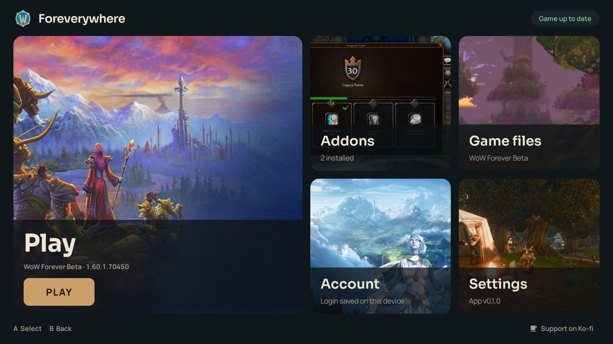
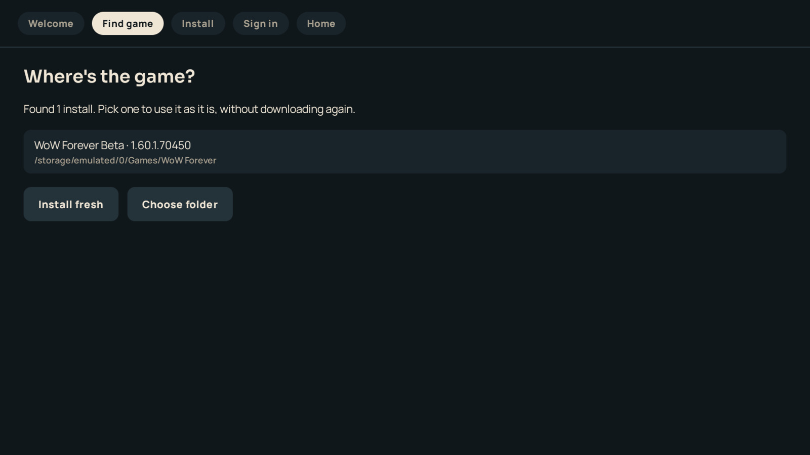
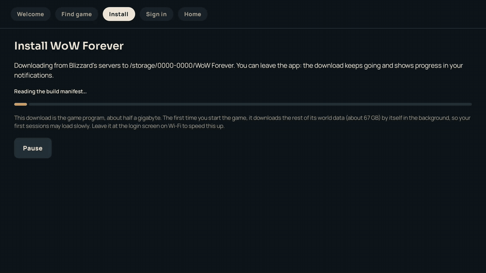
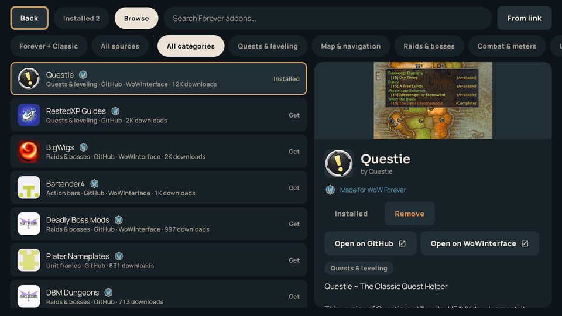
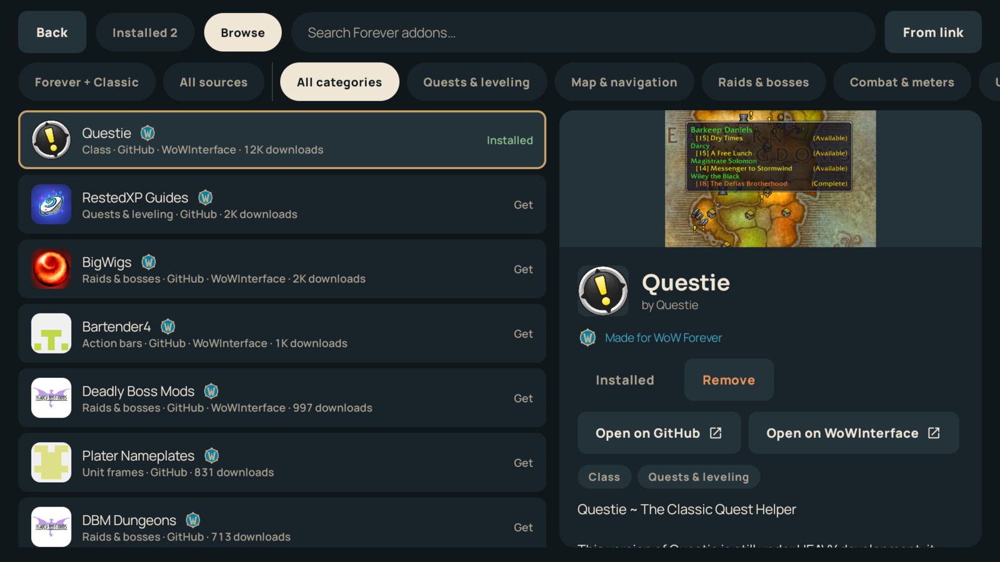
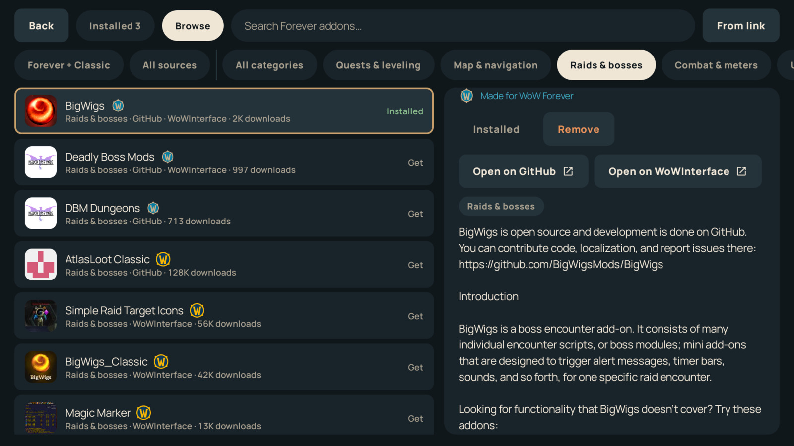
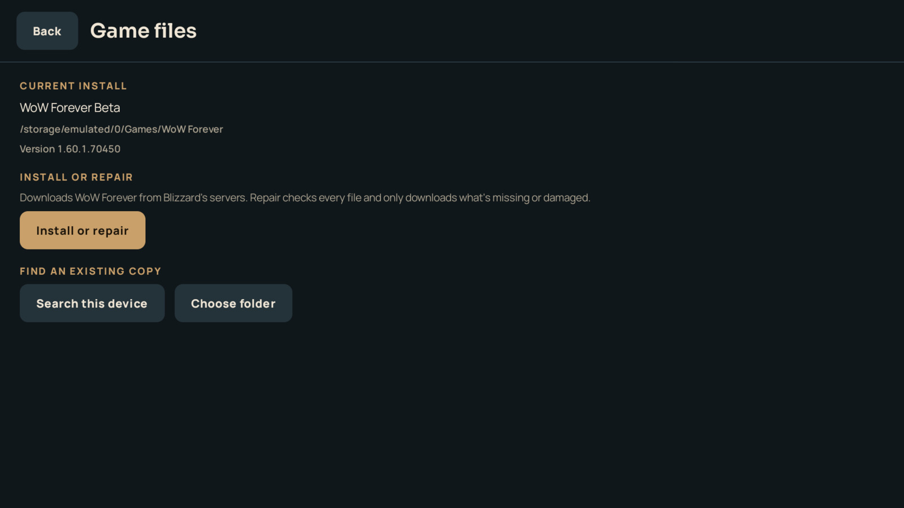
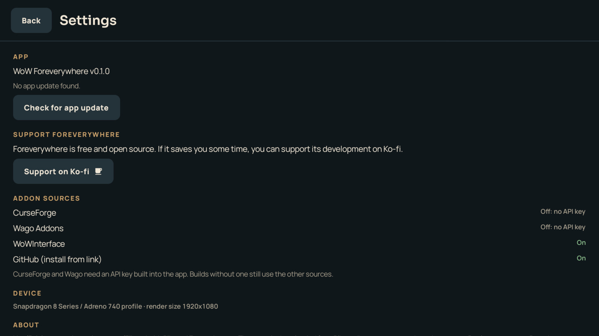

<div align="center">

# WoW Foreverywhere

**World of Warcraft: Forever on Snapdragon Android handhelds. No PC needed.**

Install the app, let it download the game from Blizzard's servers, pick your addons, and press Play.

[](https://github.com/YoruDev-Ryland/WoWForeverywhere/releases/latest)
[](https://github.com/YoruDev-Ryland/WoWForeverywhere/releases)
[](LICENSE)
[](https://ko-fi.com/rkremeier)



</div>

> [!TIP]
> ### New in 0.3.0: CurseForge support
> The addon browser now includes the full **CurseForge** catalog. Search, install and update CurseForge addons right on your handheld, with WoW Forever versions picked automatically. No account or key needed.
>
> **[Download the latest release](https://github.com/YoruDev-Ryland/WoWForeverywhere/releases/latest)** · [What's new in 0.3.0](https://github.com/YoruDev-Ryland/WoWForeverywhere/releases/tag/v0.3.0)

## Features

- **Installs the game for you.** Foreverywhere downloads the WoW Forever client straight from Blizzard's CDN to internal storage or an SD card. Downloads continue in the background, can be paused and resumed, and every file is verified.
- **Finds the copy you already have.** If WoW Forever is already on the device (copied from a PC, or set up for another launcher), the app finds it and uses it without downloading anything.
- **Keeps it up to date.** When Blizzard patches the game, the app offers the update before you play.
- **Built-in addon manager.** Search, install, update and remove addons from CurseForge, Wago, WoWInterface and GitHub, browse by category, and see at a glance which addons are made for Forever.
- **Signs you in.** Save your Battle.net login once and the game logs in by itself.
- **Made for a controller.** Every screen works with the D-pad and face buttons, and the layout adapts to small and portrait screens.

The game runs as Blizzard's own Windows ARM64 client under Wine, with DXVK and a tuned Turnip Vulkan driver for Adreno GPUs. Nothing is emulated as x86.

> [!NOTE]
> Foreverywhere is an unofficial community project. It is not affiliated with or endorsed by Blizzard Entertainment. You need your own Battle.net account with access to WoW Forever. The app and this repository contain no Blizzard game files; everything is downloaded from Blizzard's servers on your device.

## Requirements

| | |
| :--- | :--- |
| **Chip** | Snapdragon 8 series with an Adreno 7xx or 8xx GPU |
| **Android** | Android 10 or newer, 64-bit |
| **Storage** | About 80 GB free for the game (internal storage or SD card), plus about 4 GB of internal storage for the app |
| **Account** | A Battle.net account with WoW Forever |
| **Network** | Wi-Fi recommended for the first start, when the game downloads its world data |

### Devices

| Device | Chip | Status |
| :--- | :--- | :--- |
| AYN Thor | Snapdragon 8 Gen 2 | Reaches the game world with controller support |
| Retroid Pocket 6 | Snapdragon 8 Gen 2 | Reported working |
| AYN Odin 2 / Odin 2 Mini | Snapdragon 8 Gen 2 | Expected to work |
| AYN Odin 3 / Odin Portal | Snapdragon 8 Elite | Supported through the bundled Adreno 8xx driver |
| RedMagic 11 Pro | Snapdragon 8 Elite | Reported working in-world |
| Samsung Galaxy S23, S24, S25, Z Fold | Snapdragon 8 Gen 2 and later | Supported |
| Lenovo Legion Y700 Gen 3 | Snapdragon 8 Gen 3 | Reported working |
| Meta Quest 3 | Snapdragon XR2 Gen 2 | Reported working, best at minimum graphics settings |

If you try a device that isn't listed, please [open an issue](https://github.com/YoruDev-Ryland/WoWForeverywhere/issues) with the result.

## Getting started

1. Download **WoW-Foreverywhere.apk** from the [latest release](https://github.com/YoruDev-Ryland/WoWForeverywhere/releases/latest) and open it on your device. Android asks you to allow installs from your browser or file manager the first time.
2. Open **Foreverywhere** and tap **Get started**. The app checks your device and asks for file access, which it needs to install the game in a folder you can reach.
3. **Find game.** The app looks for an existing install on internal storage and SD cards. Pick one to use it as it is, or choose **Install fresh**.
4. **Install.** Choose internal storage or the SD card, pick your region (Americas, Europe, Korea or Taiwan), and start the download. You can leave the app while it runs; progress shows in your notifications.
5. **Sign in.** Optionally save your Battle.net email and password so the game logs you in automatically.
6. Press **Play**.

<p align="center">
  
  
</p>

> [!IMPORTANT]
> The app downloads the game program, about half a gigabyte. The first time you start the game, it downloads the rest of its world data (about 67 GB) on its own. Your first sessions may load slowly. Leaving the game at the login screen on Wi-Fi for a while speeds this up.

### Already have the game on a PC?

You can copy it over instead of downloading. Copy the hidden `.build.info` file and the whole `Data` folder from your Battle.net install into a folder on the device, for example `WoW Forever` on your SD card. Make sure your file manager shows hidden files, or `.build.info` gets left behind. The app finds the folder on its next scan, or you can point to it with **Game files → Choose folder**.

## Addons

The addon browser brings together CurseForge, Wago, WoWInterface and a curated catalog of addons published on GitHub. The same addon listed on several sites appears once, with a link to each site.

<p align="center">
  
</p>

- **Forever or Classic.** Each addon shows the round icon of the game version it was made for. Forever addons come first. Classic addons are listed too, with a note that they may not work in Forever. When a Forever version of an installed Classic addon appears, the app offers to switch.
- **Categories.** Browse by quests, maps, raids and bosses, unit frames, action bars, bags, auction, professions and more.
- **Updates.** The home screen shows how many addons have updates, and **Update all** installs them in one go.
- **Your existing addons.** Addons already in the game's `Interface/AddOns` folder are recognized, including ones installed by other managers.
- **Install from a link.** Paste a GitHub repository or a link to an addon `.zip` to install something that isn't listed.

<p align="center">
  
  
</p>

### Addon sources

| Source | What you get |
| :--- | :--- |
| **GitHub catalog** | Popular addons that publish releases on GitHub, such as Questie, Deadly Boss Mods, BigWigs, Plater, Dominos and Bartender4. No account or key needed. |
| **WoWInterface** | The full WoWInterface catalog. No account or key needed. |
| **CurseForge** | The largest catalog. No account or key needed. |
| **Wago Addons** | Available in builds made with a Wago Addons API key. |

The GitHub catalog lives in [`catalog/sources.json`](catalog/sources.json) and is refreshed every night. To suggest an addon, open a pull request that adds its repository. It needs GitHub releases with addon `.zip` files.

## Playing


- **Controls.** Use the D-pad or stick to move and **A** to select. **B** goes back. In the game, your handheld's controller works through WoW's own gamepad mode.
- **Back to the launcher.** While the game is starting, hold **Start + Select + L2 + R2**, or tap the back arrow, to cancel and return to the home screen.
- **In-game menu.** Press Back during play to open the sidebar with the on-screen keyboard, the performance overlay and **Exit**.
- **Authenticator codes** are still typed in the game.

### How your login is stored

Saving your login is optional, and you can remove it any time under **Account**.

- The email and password are sealed together with AES-256-GCM using a key held by the Android Keystore. The key can't be exported, and it stays in the device's secure hardware where the device has it.
- The saved login is excluded from cloud backups and from phone-to-phone transfers.
- Screenshots and screen recordings of the login form are blocked.
- To sign in, the game reads your login from a short-lived `login.txt` file in its own folder. This is how the WoW client accepts a login without the Battle.net app. Foreverywhere writes the file when you press Play and wipes it about 20 seconds after the game reads it, or within three minutes at most. It is also wiped when you leave or close the game.

Because the game needs the password in plain text for those few seconds, any app with full storage access could read it in that window. If that is a concern, skip saving your login and sign in inside the game instead.

## Settings and game files

<p align="center">
  
  
</p>

- **Game files** shows where the game is installed and its version. **Install or repair** checks every file and downloads only what's missing or damaged. Once WoW Forever launches, this screen also offers to switch a beta install to the launch version, reusing the game data you already have.
- **Settings** shows the app version and checks for app updates. It's also where you change your **region** and the game's **resolution**, which is set for your device by default; a higher resolution looks sharper but is harder on the device. Both apply the next time you start the game.

### Other WoW versions (experimental)

Foreverywhere is made for WoW Forever, but **Settings → Game version** can switch the app to another official version: Classic Era, Burning Crusade Anniversary, Mists of Pandaria Classic or Retail. The whole app then works with that version, including installing, updating, playing and the addon browser. Each version keeps its own install and addons, and switching back to WoW Forever leaves your Forever setup as it was.

These versions are experimental and get little support. They may run poorly or not start at all, and automatic sign-in may not work on every version.

## Troubleshooting

| Problem | What to do |
| :--- | :--- |
| *CAS system was unable to initialize* | The game folder is missing `.build.info`. Run **Game files → Install or repair**, or copy the file again from your PC install. |
| *No realms available* | The game is out of date. Open the app with Wi-Fi on and accept the update. |
| The game is slow the first time | It's downloading its world data in the background. Give it time on Wi-Fi. |
| The keyboard doesn't appear in the game | Force-stop Gboard under **Settings → Apps → Gboard** and open the keyboard again. |
| The app returns to the home screen after "Starting World of Warcraft" | Check the files in the game's `Errors` folder (`_forever_/Errors` or `_classic_beta_/Errors`). |
| "This device can't run the game" | The device has no Adreno GPU. The game needs a Snapdragon chip. |

## Building from source

Requirements: JDK 17 or 21 and the Android SDK.

```bash
tools/fetch_components.sh          # Wine, DXVK and Turnip runtime archives (~130 MB, checksummed)
./gradlew assembleModernRelease    # app/build/outputs/apk/modern/release/app-modern-release.apk
./gradlew testModernDebugUnitTest
```

Builds reach CurseForge through the project's proxy, which holds the API key (see [`server/curseforge-proxy`](server/curseforge-proxy)). To use your own CurseForge key instead, or to enable Wago, put the keys in `local.properties`, which is never committed:

```properties
CURSEFORGE_API_KEY=...
WAGO_API_KEY=...
```

Release builds are signed with `app/keystores/keystore.properties` when it exists and fall back to the debug key otherwise.

## Credits

Foreverywhere is a fork of [**wow-forever-android**](https://github.com/jaredgei/wow-forever-android) by jaredgei, which made WoW Forever run on Android handhelds in the first place. It in turn builds on:

- [**GameNative**](https://github.com/utkarshdalal/GameNative), [**Pluvia**](https://github.com/oxters168/Pluvia), [**Winlator**](https://github.com/brunodev85/winlator) and the [**Bionic Vulkan wrapper**](https://github.com/leegao/bionic-vulkan-wrapper) for the Android app, Wine container management and X server.
- The **WoW Forever RP6 community bundle** and [**arusiasotto**](https://github.com/arusiasotto/wow-forever-a840) for the tuned Proton 11 ARM64EC, DXVK and Turnip builds.
- [**Wine**](https://www.winehq.org/), [**Proton**](https://github.com/ValveSoftware/Proton), [**DXVK**](https://github.com/doitsujin/dxvk), [**Mesa**](https://mesa3d.org/), [**FEX-Emu**](https://github.com/FEX-Emu/FEX), [**box64**](https://github.com/ptitSeb/box64) and [**PulseAudio**](https://www.freedesktop.org/wiki/Software/PulseAudio/).

World of Warcraft, WoW Forever and the artwork shown in the app are owned by Blizzard Entertainment. The app loads that artwork from Blizzard's own servers. Full third-party license details are in [`THIRD_PARTY_NOTICES`](THIRD_PARTY_NOTICES).

## Support

Foreverywhere is free and open source. If it saves you time, you can support its development on [Ko-fi](https://ko-fi.com/rkremeier).

## License

[GPL-3.0](LICENSE). The bundled runtime components carry their own licenses; see [`THIRD_PARTY_NOTICES`](THIRD_PARTY_NOTICES).
